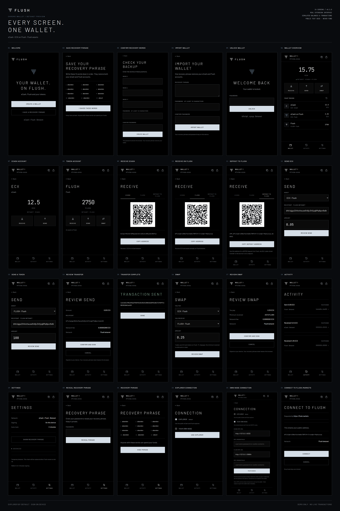

# Flush Wallet

A Chrome extension for L1 ECX, ECX on Flush, and Flush assets. Keys and transaction signing stay in the browser. The public Explorer is the default connection; using your own eCash and Flush RPC nodes is an optional setting under **Settings → Advanced → Connection**.

In Explorer mode, swap quotes come from the public Flush API at `flush.markets`; the Explorer's market proxy excludes quote routes. Address reads and transaction broadcasting use the Explorer. Own-node mode gets all of its data and quotes directly from the paired RPC nodes.

The interface follows the Flush site's colours, official mark, Barlow typography, JetBrains Mono readouts, and hairline layout.



## Demo

- [Online screen viewer](https://seriouscatsoserious.github.io/flush-wallet/) — browse all 24 screens on mobile or desktop, filter by flow, and open each capture at full resolution.
- [Full-resolution collage](docs/demo/flush-wallet-collage.png)
- [PDF collage](docs/demo/flush-wallet-collage.pdf)
- [Interactive gallery](docs/demo/gallery.html) — download and open locally; fonts and images are embedded. Filter by flow or click a screen to see it at full size.
- [Individual screenshots](docs/demo/screens) and [screen index](docs/demo/screens.json)

These are captures of the real extension UI using offline fixtures. Balances, quotes, history, and the broadcast response are simulated. The recovery phrase is a **public test vector**. Never send funds to any address in the demo. Running the demo starts no node or API service and broadcasts nothing to a live chain.

## Install in Chrome

1. Clone or download this repository.
2. Open `chrome://extensions` and enable **Developer mode**.
3. Choose **Load unpacked** and select the repository's `extension` folder.
4. Pin Flush Wallet, then create or import a recovery phrase.

The built extension is included. No node download or server is required for Explorer mode. See [INSTALL.txt](INSTALL.txt) for connection and recovery details.

## Develop

Use Node.js 22 or newer.

```sh
npm ci
npm run build
npm test
```

The build is self-contained: site design tokens, fonts, icons, and licences are included. It does not need a checkout of the site or node software.

For browser checks and demo captures, first install Chromium:

```sh
npx playwright install chromium
npm run demo
npm run test:browser
npm run test:advanced
```

`npm run demo` regenerates all 24 screenshots at 2× resolution, the collage PNG/PDF, and the standalone gallery in `docs/demo`. It also copies the fonts used by the hosted viewer. GitHub Pages serves `docs/` from `main`; the viewer is static and needs no wallet connection or server on your machine. Captures use intercepted fixture responses. The two browser tests also exercise the live Explorer; the advanced test intercepts its node RPC calls and broadcasts only to a fixture. On Linux, Playwright may need browser system libraries (`npx playwright install --with-deps chromium`).

## What works in this preview

- Local 12-word seed creation, three-word backup check, seed import, password-encrypted storage, recovery display, and auto-lock.
- Separate eCash and Flush addresses from one seed, receive QR codes, and a Flush deposit address.
- Native and token sends, swap review, site connection/transaction approvals, and activity.
- Explorer data and broadcasting, plus opt-in own-node RPC with encrypted credentials and per-host Chrome permissions requested when pairing.

This is the temporary betanet on Flush slot 99. The live Explorer currently rejects L1 address lookups with its `bitcoind` backend; those balances appear as unavailable. Token spending requires resolved per-output token metadata from the Explorer or RPC node. RPC activity includes transactions sent by this browser. Funded live-chain transfers have not been validated. Mainnet, asset creation, liquidity management, auctions, staking, and peg-outs are not enabled.

## Source layout

| Path | Purpose |
| --- | --- |
| `src/core.js` | Key derivation, vault encryption, transaction construction and signing |
| `src/background.js` | Wallet state, approvals, connection selection |
| `src/api.js` | Explorer reads, metadata, history and broadcasting |
| `src/rpc.js`, `src/connection.js` | Own-node transport and encrypted connection storage |
| `src/popup.*` | Extension screens |
| `src/provider.js`, `src/content.js` | `flush.markets` wallet interface |
| `assets/` | Bundled fonts and third-party licence notices |
| `scripts/demo.mjs` | Actual-UI demo capture and collage renderer |
| `test/` | Unit tests and browser checks |

Brand reference: [Flush site design rules](https://github.com/block-fabric/flush-markets/blob/main/docs/design.md). Font and dependency licences are in [assets/licenses](assets/licenses).
